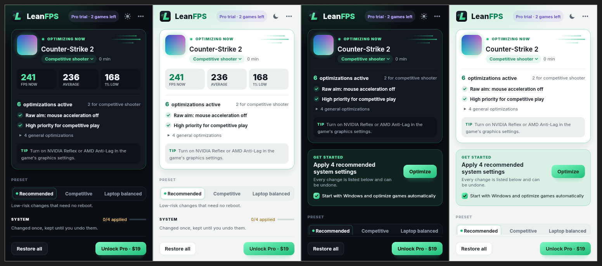

# LeanFPS

A tiny game performance optimizer for Windows 10/11, written in Rust. One ~6.5 MB
executable: no installer required, no .NET, no WebView, no account.

LeanFPS recognizes the game you are playing, applies tweaks that have a real mechanism
behind them (power plan, core parking, process priority, V-Cache placement on X3D CPUs,
genre-specific settings) and **measures your real FPS and 1% lows every session**, so you
can see whether a change actually helped. Every change saves the real previous value first
and can be undone one at a time, all at once, or automatically after a crash. It never
touches Defender, Memory Integrity, the firewall, Windows Update or CPU mitigations.



## Open source, with an optional Pro

The full source is here under the MIT license. Build it, read it, change it, ship your own
version. If you'd rather not bother, LeanFPS Pro is a one-time purchase at
<https://leanfps.com/pro/> (14-day refund, up to 3 PCs) and supports the project.

## How it compares

| | **LeanFPS** | **Radiant Optimizer** | **Hone** | **Razer Cortex** | **Tier1Suite** | **Process Lasso** | **WinUtil** | **Windows Game Mode** |
|---|---|---|---|---|---|---|---|---|
| **Price** | | | | | | | | |
| Free version | ✅ Detection, FPS measurement, core tweaks; no time limit | ✅ 8 starter tweaks; profiles only as a preview | 🟡 10 optimizations (15 with referrals), with ads | ✅ No paid tier shown | ✅ 20 of 43 catalog entries | ✅ Free edition | ✅ Free, MIT license | ✅ Built in |
| Full version price <br><sub>One PC, US prices</sub> | ✅ $19 once (early bird; $29 after release) | 🟡 $57.77 once | ❌ $5.99 a month or $39.99 a year | ✅ Free | 🟡 $29.99 once (3 PCs) | 🟡 $39.95 lifetime, or $24.95 a year | ✅ Free | ✅ Free |
| Refunds | ✅ 14 days, no questions asked | ❌ “Completed purchases are final” | 🟡 Xsolla policy; renewals only within 48 hours | ➖ Not applicable | ✅ 14 days | ✅ 30 days, no questions asked | ➖ Not applicable | ➖ Not applicable |
| **Size and footprint** | | | | | | | | |
| Download size | ✅ About 6.5 MB, one exe | ❌ 194 MB installer (v7.0.4) | 🟡 3 MB Overwolf stub, downloads more | 🟡 15 MB web installer, downloads more | ❌ 75 MB installer | ✅ 3 MB installer | ✅ 0.9 MB PowerShell script | ✅ Nothing to install |
| No account needed | ✅ No account; Pro is a license key | 🟡 Free: no. Premium: account and motherboard-locked licence | ❌ “Do I need to sign in? Yes.” | ❔ Not stated | ✅ No account | ✅ Pro needs an activation code | ✅ No account; run as administrator | ✅ No account |
| No extra platform <br><sub>Overwolf, launchers, stores</sub> | ✅ Standalone | ✅ Standalone | ❌ Delivered through Overwolf | ❌ Part of the Razer Cortex launcher, deals and rewards app | ✅ Standalone | ✅ Standalone | ✅ Script | ✅ Part of Windows |
| In the background | 🟡 Optional: checks the foreground window every 2 s, about 10 MB | ❔ Not stated | 🟡 Manages processes while you play | 🟡 Kicks in when a game launches | 🟡 Optional tray automation (Pro) | ❌ Always-on background service | ✅ Only runs when you start it | 🟡 Built into Windows |
| **Proof it works** | | | | | | | | |
| Measures your real FPS | ✅ Every session, from Windows event tracing; no overlay | 🟡 Premium “Live FPS overlay”, method not stated; home page demo is simulated | ❔ Not stated | 🟡 FPS counter; Booster Prime gives a predicted FPS | 🟡 Latency benchmark; per-game frame time “not measured” | ❌ No FPS measurement stated | ❌ None | ❔ Not stated |
| 1% lows saved per session <br><sub>To see whether a tweak really helped</sub> | ✅ Average, 1% and 0.1% lows, compared with your usual | ❔ Not stated | ❔ Not stated | ❔ Not stated | ❌ Not measured | ❌ | ❌ | ❔ Not stated |
| Per-game or per-genre profiles | ✅ 8 genres, detected automatically | 🟡 Premium only | 🟡 Presets “where available” | 🟡 Booster Prime: 7 games | 🟡 1 free, unlimited in Pro | ✅ Per-process rules | ❌ | ❌ |
| **Safety** | | | | | | | | |
| Never weakens security <br><sub>Defender, Memory Integrity, Windows Update, firewall, mitigations</sub> | ✅ None of these are in the tweak list | ❔ Not stated | ❔ Not stated | ❔ Not stated | 🟡 Offers turning off VBS / Memory Integrity (opt-in, Pro) | ❔ Not stated | 🟡 Optional “Disable Updates” stops security updates | ✅ Only holds back driver installs and restart prompts |
| Undo one change at a time | ✅ Real previous value saved before each change | 🟡 “Supported settings” have backup or undo | 🟡 Supported registry tweaks | 🟡 Restores after gaming; Booster Prime has Revert | ✅ Per-tweak revert and revert all | ✅ No changes left after uninstall | ✅ “Undo Selected Tweaks” | ✅ One switch |
| Recovers after a crash | ✅ Journal on disk; next start reverses an open session | 🟡 Restore point before every change | ❔ Not stated | ❔ Not stated | 🟡 Restore point before changes | ❔ Not stated | 🟡 Optional restore point | ❔ Not stated |
| Anti-cheat | ✅ No injection, no overlay; uses Windows launch priority when blocked | 🟡 Says compatible, “not responsible for any bans” | ❔ Not stated | 🟡 Booster Prime “is not a cheat” | ✅ No injection, no kernel driver | ✅ “Will not cause bans” | ❔ Not stated | ✅ Part of Windows |
| **Privacy and support** | | | | | | | | |
| Sends nothing from your PC | ✅ No telemetry; network only to activate and refresh Pro | ❌ Registered users “cannot opt out” of usage data | ❌ May collect hardware, BIOS settings, installed games | ❔ Not stated | 🟡 Update check; usage data only if you opt in | ✅ Only activation and update checks | ❔ Not stated | ❔ Not stated |
| Open source | ✅ MIT | ❌ | ❌ | ❌ | ❌ | ❌ | ✅ MIT | ❌ |
| Support | ✅ Email: contact@leanfps.com | 🟡 Discord only | ✅ Contact page, Discord | ✅ Razer support | ✅ Contact form | ✅ Forum, contact form | ✅ GitHub issues, Discord | ✅ Microsoft support |

✅ yes · 🟡 partly · ❌ no · ➖ not applicable · ❔ not stated by the maker. Competitor facts come only from each maker's own pages, read on 2026-10-10; anything they don't state is marked as not stated. Prices are US prices for one PC.

Sources:

- Radiant Optimizer: <https://radiantoptimizer.com/plans.html>, <https://radiantoptimizer.com/refund-policy.html>, <https://radiantoptimizer.com/terms.html>, <https://radiantoptimizer.com/privacy.html>
- Hone: <https://hone.gg/>, <https://hone.gg/premium>, <https://hone.gg/download>, <https://hone.gg/privacy>, <https://hone.gg/refund-policy>
- Razer Cortex: <https://www.razer.com/cortex>, <https://www.razer.com/cortex/booster>, <https://www.razer.com/cortex/booster-prime>
- Tier1Suite: <https://tier1settings.com/tier1suite/>, <https://tier1settings.com/privacy/>
- Process Lasso: <https://bitsum.com/>, <https://bitsum.com/get-lasso-pro/>, <https://bitsum.com/process-lasso-faq/>, <https://bitsum.com/privacy-policy/>
- WinUtil: <https://github.com/ChrisTitusTech/winutil>
- Windows Game Mode: <https://support.xbox.com/en-US/help/games-apps/game-setup-and-play/use-game-mode-gaming-on-pc>

## What it does

- **System tweaks** (persistent): power plan, core parking, Game Mode, background recording,
  Windows 11 optimizations for windowed games, plus advanced opt-ins (HAGS, MPO). The real previous value is saved before every change and
  restored on undo, one tweak at a time or all at once.
- **While gaming** (session): when a game is in the foreground LeanFPS raises its priority,
  opts it out of power throttling, keeps the PC awake and lowers background apps. On Ryzen
  X3D CPUs with two dies the game runs on the V-Cache die (Windows CPU sets). Everything
  is undone when the game exits, and after a crash on the next start.
- **Game profiles**: the game is identified (built-in database, Steam and Epic libraries,
  or fullscreen fallback), its icon is shown, and genre-specific tweaks run (e.g. mouse
  acceleration off for shooters, standby-memory purge for open-world games).
- Never: Defender, HVCI/VBS, firewall, Windows Update, CPU mitigations, game injection or
  overlays.

## Safety rules

- **Record first, then modify.** Every change reads the current value and writes it to the
  undo journal on disk (flushed) before touching the system. If the journal can't be saved,
  nothing is changed. If a change fails half-way, what was done is undone.
- **Nothing is forgotten.** A value that can't be restored stays in the journal (or
  `session.json`) and is retried by the next start or **Restore all**. A journal file that
  can't be read is moved aside as `*.corrupt-<time>`, never overwritten.
- **Exact restore.** Registry values of any type are restored byte for byte.
- **No files, no drives.** LeanFPS never deletes or edits user files. It only writes its own
  JSON files in its data folder. No disk cleanup, no driver or service changes.
- **No freezes.** Priority goes up to High at most, never Realtime. Windows processes
  (`dwm.exe`, `csrss.exe`, `audiodg.exe`, `explorer.exe`, ...) are never slowed down; the
  catalog is rejected if it lists one. Mouse changes live in memory only, so a reboot always
  resets them.

## Layout

```
data/tweaks.toml      tweak catalog (what, why, risk, sources, actions)
data/games.toml       known games: exe -> name, genre; tips per genre
src/catalog.rs        catalog types + validation
src/engine.rs         apply / revert with a journal of real prior values
src/session.rs        per-game session tweaks, crash recovery
src/watcher.rs        background thread: foreground game detection every 2 s
src/games/            game database, Steam/Epic library scan, classification
src/platform/         Platform trait; win.rs = Win32, mock.rs = tests and Linux dev
src/ui.rs             egui window (380 x 660), light and dark themes from the icon colors
src/selftest.rs       `--selftest`: apply/verify/revert everything on a real system
```

## Build and test

```bash
cargo test                      # any OS, uses the mock platform
cargo build --release           # on Windows: target/release/leanfps.exe
# cross-compile from Linux (needs mingw-w64 and `rustup target add x86_64-pc-windows-gnu`)
cargo build --release --target x86_64-pc-windows-gnu
```

On Linux `cargo run` opens the window against a demo mock (CS2 "running") for UI work.
Data goes to `%ProgramData%\LeanFPS` (override with `LEANFPS_DATA_DIR`).

## Build on your own Windows PC

1. Install **Visual Studio Build Tools 2022** with the workload "Desktop development with C++"
   (MSVC compiler + Windows SDK).
2. Install Rust from https://rustup.rs (default toolchain `stable-x86_64-pc-windows-msvc`).
3. In a new terminal:

   ```powershell
   git clone https://github.com/Jamailar/leanfps
   cd leanfps
   cargo test
   cargo build --release
   ```

   The result is `target\release\leanfps.exe` (single file, about 6.5 MB). The first build
   downloads dependencies and takes a few minutes.
4. Double-click `leanfps.exe`. Windows asks for administrator rights (needed for power plans
   and process priority). The exe is not code-signed yet, so SmartScreen may show
   "Windows protected your PC": choose *More info* > *Run anyway*.

Or install it: CI also builds `LeanFPS-Setup-<version>.exe` from `installer/leanfps.iss`
(Inno Setup). It installs to Program Files, adds a Start menu entry and a desktop shortcut,
and its uninstaller runs `--restore-all` before removing the program.

If the window does not open, LeanFPS shows the reason and writes it to
`C:\ProgramData\LeanFPS\leanfps.log`. It draws with OpenGL and falls back to Direct3D 12
(GPU or Windows' software renderer) on PCs without a usable OpenGL driver, such as virtual
machines.

Undo everything at any time with the **Restore all** button or `leanfps.exe --restore-all`.
Settings and the undo journal are in `C:\ProgramData\LeanFPS`. Do not run `--selftest` on your
own PC: it is meant for throwaway test machines and refuses to run unless `CI=true` or
`LEANFPS_SELFTEST=1` is set.

Command line:

```
leanfps                 open the window
leanfps --restore-all   undo every change, then exit (used by uninstall)
leanfps --selftest      apply, verify and undo every tweak; writes leanfps-selftest.log
```

`--selftest` changes real system settings. Run it only on a throwaway machine; CI runs it on
the GitHub Windows runner (`.github/workflows/ci.yml`), which also enforces a 12 MB
size budget.

## Game database

Executable names in `data/games.toml` come from public sources and still need checking on real
installs. A wrong entry only means the game is detected through the Steam/Epic library or the
fullscreen fallback instead.

## Status

Done: engine, catalog, detection, sessions, window,
selftest, CI, Pro license key activation. Next: frametime measurement (ETW), code signing.

## Pro license

Pro is a one-time purchase on https://leanfps.com/pro/. The buyer gets a key by email and
enters it with **Enter key** (footer) or *Settings > License*. `src/license.rs` activates it
through the license server (`https://api.hyperchaos.dev/leanfps/v1/licenses/...`) and saves the signed file as `license.json` in
the data folder. Every start verifies it offline (Ed25519, public keys in `PUBLIC_KEYS`);
a background refresh runs when the file asks for one. Network errors never remove the file;
only a definite refusal from the server (refunded, device removed) does.
`tools/license_fixture.mjs` regenerates the signed test fixture.

## Icons

Sources are SVG in `res/icon/` (`app.svg` large, `app-small.svg` for 16-32 px, `tray-idle.svg`,
`tray-active.svg`). `res/icon/build-icons.sh` regenerates `res/leanfps.ico`,
`res/tray-*.ico` and `res/window-64.rgba`. Preview: `docs/icons-preview.png`.

The window uses Inter (SIL Open Font License, `res/fonts/OFL.txt`), subset to Latin to keep
the exe small. Window preview in both themes: `docs/ui-preview.png`.

## License

MIT, see `LICENSE`. The Inter fonts in `res/fonts/` are under the SIL Open Font License.
